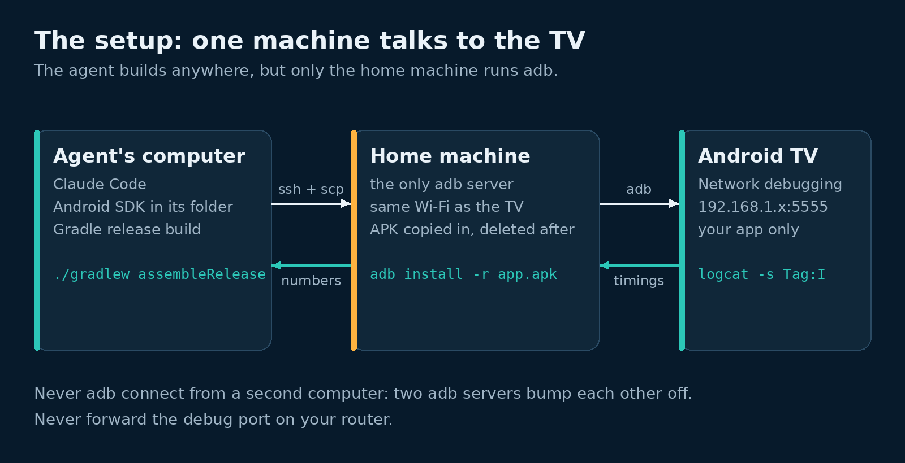

# Have Claude build an Android TV app, sideload it over ADB, then hill-climb a latency metric

## What it does

Have a coding agent build a native Android TV app, install it on your TV over the network with ADB, and then improve one measured number in a loop: the time from picking a stream to its first frame on screen.

Jake shared the idea in The Colab. Claude built him an Android TV app, installed it on a Google TV Streamer over ADB, and spent a night cutting stream switch time from 1.85 s to 0.84 s. Adam then had Claude build a wall dashboard for an Nvidia Shield TV the same way. This module uses that build as the worked example, with its real commands and numbers.

The lessons:

1. ADB: install it and use it (this lesson).
2. Turn on network debugging on the TV.
3. Scaffold a small Compose for TV app.
4. Worked example: how Kev TV was built.
5. Put the TV on Tailscale and pair the app, all over ADB.
6. Measure time to first frame.
7. Hill-climb the number.
8. Keep a shared TV safe while an agent works on it.

## What you need

- An Android TV device: Nvidia Shield, Google TV Streamer, Chromecast with Google TV, or a TV with Android TV built in. We used a Shield on Android 11.
- A computer on the same home network as the TV.
- Android SDK Platform-Tools, for the `adb` command. You don't need Android Studio.
- Java 17 or later, for `sdkmanager`.
- A coding agent that can run shell commands, such as Claude Code.



The agent can run on any computer. Pick one machine on the home network to run adb. Send every install and every measurement through it. In our build the agent ran on a separate server and reached that machine over SSH.

## Steps

1. Open the Android Studio download page (link below). Scroll to **Command line tools only**. Download the zip for your OS.
2. Check the zip against the SHA-256 listed on that page.

   ```bash
   sha256sum commandlinetools-linux-*_latest.zip
   ```

3. Unzip it into your home folder. No admin rights needed.

   ```bash
   mkdir -p ~/android/cmdline-tools
   unzip commandlinetools-linux-*_latest.zip -d ~/android/cmdline-tools
   mv ~/android/cmdline-tools/cmdline-tools ~/android/cmdline-tools/latest
   ```

4. Install Platform-Tools with `sdkmanager`. It checks each download against Google's checksums.

   ```bash
   ~/android/cmdline-tools/latest/bin/sdkmanager --sdk_root="$HOME/android" "platform-tools"
   ```

5. Put `adb` on your PATH.

   ```bash
   export PATH="$HOME/android/platform-tools:$PATH"
   ```

6. Turn on network debugging on the TV. Lesson 2 has the menus. Note the address it shows, for example `192.168.1.x:5555`. (untested)
7. Connect to the TV.

   ```bash
   adb connect 192.168.1.x:5555
   ```

8. On the TV, a prompt shows your computer's key. Tick **Always allow from this computer** and pick **OK**. (untested)
9. Check the TV shows as `device`, not `unauthorized`. (untested)

   ```bash
   adb devices -l
   ```

10. Install your app. `-r` replaces it and keeps its data, so a paired app stays paired.

    ```bash
    adb -s 192.168.1.x:5555 install -r app-release.apk
    ```

11. Start it.

    ```bash
    adb -s 192.168.1.x:5555 shell am start -n com.example.tv/.MainActivity
    ```

12. Read the app's log lines. `-s TAG:I` shows only your tag.

    ```bash
    adb -s 192.168.1.x:5555 logcat -d -s MyAppTiming:I
    ```

13. Take a screenshot. `exec-out` sends the PNG straight to your computer.

    ```bash
    adb -s 192.168.1.x:5555 exec-out screencap -p > shot.png
    ```

14. Go back to the home screen when you're done. (untested)

    ```bash
    adb -s 192.168.1.x:5555 shell input keyevent KEYCODE_HOME
    ```

## Gotchas

- Pass `-s <address>` on every command once more than one device is connected. Without it adb refuses or picks the wrong one.
- `unauthorized` means nobody accepted the prompt on the TV. Look at the TV. (untested: run `adb kill-server`, then connect again, to get a fresh prompt.)
- Run adb from one machine only. Two adb servers connected to the same TV bump each other off.
- A 4K screenshot is several MB. Scale it down before an agent looks at it.
- `adb install -r` keeps the app's data. `adb uninstall` deletes it, pairing included. Never uninstall an app you didn't install.

## Notes

Status of this module: `draft`.

What was run, on 8 Nov 2026:

- Steps 1 to 5 on Linux (Temurin JDK 17.0.21, command-line tools 22.0, Platform-Tools 37.0.1). The SDK went into a project folder, not `~/android`. The commands are otherwise the same.
- Steps 7 and 10 to 13 many times, from a Linux machine on the home network, against an Nvidia Shield TV on Android 11 (API 30) over network debugging on port 5555.

What was not run, and why:

- Steps 6 and 8: network debugging was already on, and the home machine was already trusted, before this build started.
- Steps 9 and 14 and `adb kill-server`: we have no record of these being run in this build. They are standard adb commands from the Android docs.
- Lessons 2 to 8 list their own tested and untested steps.

## Links

- [Android Debug Bridge (adb)](https://developer.android.com/tools/adb)
- [Android Studio downloads (command line tools)](https://developer.android.com/studio#command-line-tools-only)
- [SDK Platform-Tools release notes](https://developer.android.com/tools/releases/platform-tools)
- [sdkmanager](https://developer.android.com/tools/sdkmanager)
- [Run apps on a hardware device](https://developer.android.com/studio/run/device)
- [Android TV developer guides](https://developer.android.com/training/tv)
