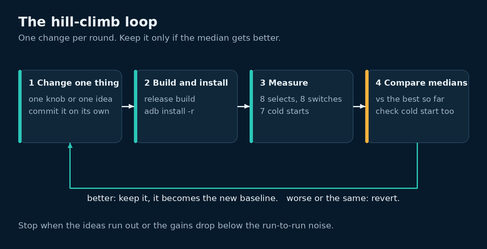

# Hill-climb the number

Once the agent can measure the number on its own (lesson 6), the rest is a loop. Change one thing. Build and install it. Measure it. Keep it if it's better, throw it away if not.



Our loop got as far as three measured builds of the starting point. Adam then stopped it so the agent could move the app onto live data. So this lesson has real setup and real baseline numbers, but no optimisation round. What we learned from the baselines is still the most useful part.

## The rules we gave the agent

1. **One main number.** Time from picking a camera to its first frame, as a median of at least 7 runs.
2. **One guard number.** Cold start to the app's first frame. It must not get worse.
3. **Use the real TV.** We skipped the emulator. Its numbers wouldn't match the TV's.
4. **Use demo mode and public test streams**, so nothing real is shown or recorded.
5. **Write every trial down** in one tab-separated file, `results.tsv`, with the build's name.
6. **Pause if someone else is using the TV.** If another app comes to the front, wait and check again every 10 minutes.
7. **Press Home when finished.**
8. **Stop after about 3 hours.**

The plan for each round (not reached, so untested):

1. Make one change, in its own commit, so a bad round is one `git revert`.
2. Build release, install with `adb install -r`, measure.
3. Keep the change only if it beats the best build so far by more than the noise. Revert a tie. It adds code for nothing.

## The measuring script

The agent wrote a script that runs on the home machine, the one with adb. It prints one tab-separated line per trial: build name, kind, trial number, stream, ms. Here is ours. Only the address, package name, launcher and log tag are changed to placeholders.

```bash
#!/usr/bin/env bash
# measure.sh <variant> [n] [cold_n]: cold starts, then n selects, each followed by a switch.
set -uo pipefail
v=$1; n=${2:-8}; cold=${3:-7}
A="adb -s 192.168.1.x:5555"
P=com.example.tv
top() { $A shell dumpsys activity activities | grep -m1 mResumedActivity; }
# Ours, the launcher, the screensaver, or nothing in front.
ours() { t=$(top); [ -z "$t" ] || grep -qE "$P|YOUR_LAUNCHER_PACKAGE|Dream" <<<"$t"; }
guard() { until ours; do echo "# $(date +%H:%M) another app in front, waiting 10 min" >&2; sleep 600; done; }
# End a screensaver so frames really reach the screen. Changes no settings.
wake() { $A shell input keyevent KEYCODE_WAKEUP; }
front() { top | grep -q "$P"; }
# Wait up to 15 s for a first frame after the last select. Print the gap in ms, or NA.
delta() {
  for _ in $(seq 1 60); do
    l=$($A logcat -d -s MyAppTiming:I)
    s=$(grep -o 'cam_select uptime=[0-9]*' <<<"$l" | tail -1 | cut -d= -f2)
    f=$(grep -o 'cam_first_frame uptime=[0-9]*' <<<"$l" | tail -1 | cut -d= -f2)
    if [ -n "$s" ] && [ -n "$f" ] && [ "$f" -ge "$s" ]; then
      grep -oE 'cam_(select|load|decoder|format|first_frame) .*' <<<"$l" | sed 's/^/# /' >&2
      echo $((f - s)); return; fi
    sleep 0.25
  done
  echo NA
}
guard
for i in $(seq 1 "$cold"); do
  guard; wake
  $A shell am force-stop $P; wake; sleep 1
  t=$($A shell am start -W -n $P/.MainActivity --ez demo true | awk '/TotalTime/{print $2}')
  front || t=NA
  echo -e "$v\tcold\t$i\t-\t$t"; sleep 3
done
wake; $A shell am force-stop $P; sleep 1
$A shell am start -n $P/.MainActivity --ez demo true --ei dwell 600 >/dev/null; sleep 8
for i in $(seq 1 "$n"); do
  guard; wake
  front || { $A shell am start -n $P/.MainActivity --ez demo true --ei dwell 600 >/dev/null; sleep 6; }
  c=$(( (i - 1) % 4 ))
  $A logcat -c
  $A shell am start -n $P/.MainActivity --ei camera $c >/dev/null
  echo -e "$v\tselect\t$i\t$c\t$(delta)"; sleep 2
  $A logcat -c
  $A shell input keyevent 22
  echo -e "$v\tswitch\t$i\t$(( (c + 1) % 4 ))\t$(delta)"; sleep 2
  $A shell input keyevent 4; sleep 3
done
```

Some notes on it:

- To find your launcher's package, go to the home screen and run `adb shell dumpsys activity activities | grep mResumedActivity`.
- `--ei dwell 600` is a Kev TV extra. It holds each page for 600 s, so the app doesn't rotate away mid-run. Kev TV saves it, so set it back afterwards (`--ei dwell 25` for Kev TV).
- Stage logs (lesson 6) go to stderr with a `#` in front. The TSV stays clean.

The agent ran it from the build server with a small wrapper. The wrapper built and installed the release, copied the script over, ran it and printed the medians:

```bash
./deploy.sh release                       # build release, copy APK, adb install -r
scp -q measure.sh home-machine:measure.sh
ssh home-machine bash measure.sh "$v" "$n" "$cold" </dev/null | tee -a results.tsv
```

```python
import sys, statistics as st
rows = [l.rstrip("\n").split("\t") for l in open("results.tsv") if l.startswith(sys.argv[1] + "\t")]
for k in ("cold", "select", "switch"):
    xs = [int(r[4]) for r in rows if r[1] == k and r[4].isdigit()]
    if xs:
        print(f"{sys.argv[1]} {k}: n={len(xs)} median={st.median(xs):.0f} min={min(xs)} max={max(xs)}")
```

## Our numbers

Three builds, all of the starting code, on 8 Nov 2026. All times in ms. `NA` means no first frame within 15 s.

| Build | What changed | Cold start | Select | Switch |
|---|---|---|---|---|
| v0 | First run | 513 (7 runs) | 262 (6 runs, 2 NA) | 443 (6 runs, 2 NA) |
| v0r | Dead test stream replaced, and the memory fix from lesson 4 | 507 (7) | 784 (8) | 1585 (8) |
| v0b | Stage logs added only. No change in behaviour. | 509 (7) | 266 (12) | 362 (12) |

The same numbers by stream, select and switch together:

| Stream | v0 | v0r | v0b |
|---|---|---|---|
| 0, live test stream | all NA | 1585 | 1591 |
| 1, video on demand | 291 | 1075 | 257 |
| 2, video on demand | 229 | 768 | 212 |
| 3, video on demand | 264 | 283 | 278 |

Cold start barely moved: 507 to 513 ms.

## What we learned

**A dead stream looked like a win.** In v0, stream 0 returned HTTP 404, so every stream 0 trial was `NA`. The script left them out of the median. So v0 measured only the three fast streams, and looked faster than it was. If the agent had kept a change on that basis, it would have kept a broken build. Count your `NA`s, and treat any `NA` as a failed round.

**Noise beat most changes.** v0r and v0b run the same playback code. They ran minutes apart. Streams 1 and 2 were three to four times slower in v0r. Nothing in the app changed. The network or the stream's CDN did. Most changes you'd try save less than that.

**First visits are different.** The first visit to a stream in each run was often 2.5 to 3.5 s. Repeat visits were usually under 0.3 s, or about 1.6 s for the live stream. With 8 trials over 4 streams, one slow first visit moves the median a lot.

**The network is the wait.** The stage logs (lesson 6) showed the decoder starting in 20 to 34 ms. Playlist loads that missed the cache took 270 to 2,000 ms each. Time spent on the decoder would be wasted.

So, before you trust a hill-climb on a home network:

- Compare per-stream medians, not one median over all streams.
- Report first visits apart from repeat visits.
- Run the old and new builds back to back, A B A B, so both see the same network.
- Treat any `NA` as a failure, not a missing number.

## Ideas we didn't get to

These were next on the list. None were tried, so all are untested.

- Load the next and previous stream's playlists in the background, so Left and Right find them cached.
- Start at a lower bitrate, so the first segment is smaller.
- Keep the player and its surface alive between cameras, instead of making a new one.
- For live streams, start nearer the live edge, so less has to load before the first frame.

For a sense of what's possible: Jake's loop on a Google TV Streamer took his switch time from 1.85 s to 0.84 s.

## Notes

Run on 8 Nov 2026 on an Nvidia Shield TV with Android 11, release builds, demo mode, from a Linux machine on the home network. The numbers come from the run's `results.tsv` (77 rows). The loop was stopped after the three baseline builds, before any keep-or-revert round, so the round plan above is untested.

## Links

- [ExoPlayer: live streaming](https://developer.android.com/media/media3/exoplayer/live-streaming)
- [DefaultLoadControl](https://developer.android.com/reference/androidx/media3/exoplayer/DefaultLoadControl)
- [App startup time](https://developer.android.com/topic/performance/vitals/launch-time)
- [Big Buck Bunny](https://peach.blender.org/) and [Tears of Steel](https://mango.blender.org/), Blender Foundation, CC BY
