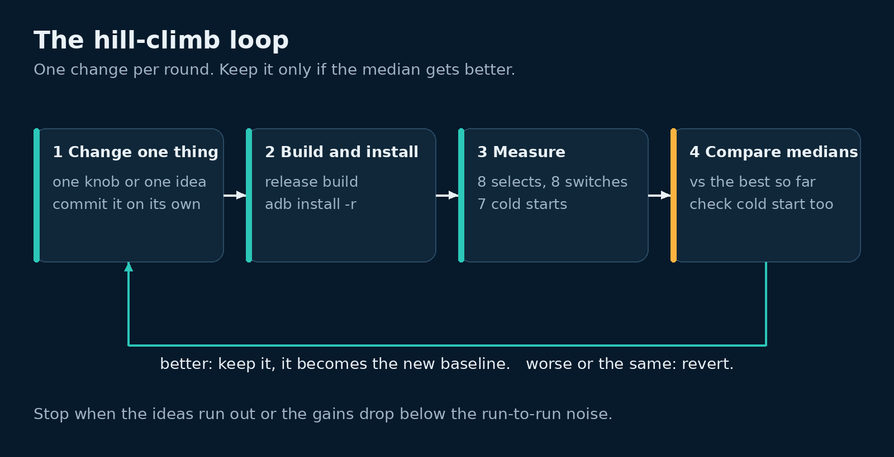

# Hill-climb the number

Once the agent can measure the number on its own (lesson 8), the rest is a loop. Change one thing. Build and install it. Measure it. Keep it if it's better, throw it away if not.



Our run got as far as three measured baseline builds. Then it was stopped so the app could go live. So this lesson has a real script and real baseline numbers, but no keep-or-revert round. What the baselines showed is still the most useful part.

## Rules to give the agent

```markdown
## Hill-climb rules
1. Main number: time from picking a stream to its first frame, as the median
   per stream. Run at least 16 trials, so each stream gets 8 visits (selects
   plus switches). More is better.
2. Guard number: cold start. It must not get worse.
3. Real TV only, release builds only, demo mode and the fixed test streams only.
4. Don't change how the number is measured.
5. Baseline first: measure the current build twice before any change.
6. One change per build, in its own commit, so a bad round is one `git revert`.
7. Keep a change only if it beats the best build by more than the gap between
   the two baselines. Revert a tie: it adds code for nothing.
8. Any NA in a build means that build failed. Find out why before going on.
9. Write every trial to results.tsv with the build's name.
10. Follow the TV rules (lesson 3). Pause while someone else uses the TV.
11. Stop after 3 hours, or when the last three ideas didn't help.
```

## Steps

1. Save the measuring script below as `measure.sh` on the adb machine. Fill in your launcher's package. To find it, go to the home screen and run:

   ```bash
   adb -s 192.168.1.x:5555 shell dumpsys activity activities | grep -m1 -E "topResumedActivity|mResumedActivity"
   ```

2. Build, install and measure the first baseline (the wrapper is below).

   ```bash
   ./hill.sh v0 16 7
   ```

   That is 7 cold starts and 16 trials. Each trial selects one stream and then switches to the next, so 16 trials over 4 streams give each stream 8 visits. Our baselines used 8 and 12 trials, so 4 and 6 visits per stream. That was too few (see What we learned).

3. Measure a second baseline of the same code, straight after. The gap between the two is your noise. (We ran a third baseline instead of a second; see below.)
4. Make one change in its own commit, and measure it. (untested)

   ```bash
   ./hill.sh v1-prefetch 16 7
   ```

5. Compare per-stream medians with the best build so far. Keep it, or `git revert` it. (untested)
6. Repeat from step 4. (untested)

## The measuring script

It runs on the adb machine. It prints one tab-separated line per trial: build name, kind, trial number, stream, ms. Stage logs (lesson 8) go to stderr with a `#` in front, so the results stay clean.

```bash
#!/usr/bin/env bash
# measure.sh <build> [n] [cold_n]: cold starts, then n selects, each followed by a switch.
set -uo pipefail
v=$1; n=${2:-16}; cold=${3:-7}
A="adb -s 192.168.1.x:5555"
P=com.example.tv
# Android 13+ prints topResumedActivity; Android 11-12 print mResumedActivity.
top() { local d; d=$($A shell dumpsys activity activities 2>/dev/null); grep -m1 -E "topResumedActivity|mResumedActivity" <<<"$d"; }
# Ours, the launcher or the screensaver in front. Empty output (an adb error, or a
# sleeping TV) counts as "someone might be watching".
ours() { local t; t=$(top); [ -n "$t" ] && grep -qE "$P|YOUR_LAUNCHER_PACKAGE|Dream" <<<"$t"; }
guard() { until ours; do echo "# $(date +%H:%M) another app in front, or adb could not tell: waiting 10 min" >&2; sleep 600; done; }
# End a screensaver so frames really reach the screen. Changes no settings.
wake() { $A shell input keyevent KEYCODE_WAKEUP; }
front() { local t; t=$(top); grep -q "$P" <<<"$t"; }
# Put back what the run changed, then go home. Runs at the end, and on Ctrl-C, kill,
# hang-up or a closed output pipe (a dropped ssh). Not on kill -9 or a crash.
# It waits until the TV is free first. Press Ctrl-C again to skip it.
restore() {
  trap - EXIT
  echo "# end of run: restoring the TV (waits if someone is watching)" >&2
  guard
  # Our app saves its page time, and this run set it to 600 s. Put yours back here.
  $A shell am start -n $P/.MainActivity --ei dwell 25 >/dev/null; sleep 2
  $A shell input keyevent KEYCODE_HOME
}
trap restore EXIT
trap 'exit 130' INT TERM
# On a hang-up or closed pipe, go quiet first: the output may be gone.
trap 'exec >/dev/null 2>&1; exit 129' HUP
trap 'exec >/dev/null 2>&1; exit 141' PIPE
# Wait for a first frame after the last select: 60 polls, about 15-30 s in all.
# Print the gap in ms, or NA.
delta() {
  for _ in $(seq 1 60); do
    l=$($A logcat -d -s MyAppTiming:I)
    s=$(grep -o 'stream_select uptime=[0-9]*' <<<"$l" | tail -1 | cut -d= -f2)
    f=$(grep -o 'stream_first_frame uptime=[0-9]*' <<<"$l" | tail -1 | cut -d= -f2)
    if [ -n "$s" ] && [ -n "$f" ] && [ "$f" -ge "$s" ]; then
      grep -oE 'stream_(select|load|decoder|first_frame) .*' <<<"$l" | sed 's/^/# /' >&2
      echo $((f - s)); return; fi
    sleep 0.25
  done
  echo NA
}
guard
for i in $(seq 1 "$cold"); do
  guard; wake
  $A shell am force-stop $P; wake; sleep 1
  t=$($A shell am start -W -n $P/.MainActivity --ez demo true | awk '/TotalTime/{print $2}')
  [ -n "$t" ] || t=NA
  front || t=NA
  echo -e "$v\tcold\t$i\t-\t$t"; sleep 3
done
wake; $A shell am force-stop $P; sleep 1
$A shell am start -n $P/.MainActivity --ez demo true --ei dwell 600 >/dev/null; sleep 8
for i in $(seq 1 "$n"); do
  guard; wake
  front || { $A shell am start -n $P/.MainActivity --ez demo true --ei dwell 600 >/dev/null; sleep 6; }
  c=$(( (i - 1) % 4 ))
  $A logcat -c
  $A shell am start -n $P/.MainActivity --ei stream $c >/dev/null
  echo -e "$v\tselect\t$i\t$c\t$(delta)"; sleep 2
  $A logcat -c
  $A shell input keyevent 22
  echo -e "$v\tswitch\t$i\t$(( (c + 1) % 4 ))\t$(delta)"; sleep 2
  $A shell input keyevent 4; sleep 3
done
```

Notes on it:

- `--ei dwell 600` is our app's test hook. It holds each page for 600 s, so the app doesn't rotate away mid-run. The app saves it, so `restore` sets it back.
- `restore` runs from a `trap`. It runs when the script ends, and when it stops early on Ctrl-C, `kill`, a hang-up, or a closed output pipe, for example when the wrapper or the SSH connection dies. It does not run after `kill -9`, a crash or a power cut.
- Over SSH with no terminal, the script only notices a dropped connection the next time it prints. So the restore can start a while late.
- `restore` waits for the TV to be free before it brings the app forward or presses Home. Otherwise it could throw someone out of what they are watching. It prints one line first. After a hang-up or a closed pipe it stays silent, because its output may be gone.
- For long runs, start the script on the adb machine so it doesn't depend on your SSH connection. By hand, run it inside `tmux`. From an agent, use `nohup` and write to files, then poll them. (untested)

  ```bash
  ssh adb-machine 'nohup bash tv-apk/measure.sh v0 16 7 >tv-apk/v0.tsv 2>tv-apk/v0.log </dev/null &'
  ssh adb-machine 'tail -2 tv-apk/v0.tsv'
  ssh adb-machine 'cat tv-apk/v0.tsv' >> results.tsv
  ```

  Only copy the results once the run has finished. `pgrep -f measure.sh` on the adb machine prints nothing then.
- A TV that is asleep can make the front-app check print nothing. The script then waits. Wake the TV with the remote if you want it to go on.

## The wrapper

The agent ran this from the build machine. It builds and installs the release, copies the script over, runs it and prints the medians.

```bash
#!/usr/bin/env bash
# hill.sh <build> [n] [cold_n]
set -euo pipefail
v=$1; n=${2:-16}; cold=${3:-7}
[ -f results.tsv ] || printf 'build\tkind\ttrial\tstream\tms\n' > results.tsv
./deploy.sh release
scp -q measure.sh adb-machine:tv-apk/measure.sh
ssh adb-machine bash tv-apk/measure.sh "$v" "$n" "$cold" </dev/null | tee -a results.tsv
python3 - "$v" <<'PY'
import sys, statistics as st
rows = [l.rstrip("\n").split("\t") for l in open("results.tsv") if l.startswith(sys.argv[1] + "\t")]
for k in ("cold", "select", "switch"):
    xs = [int(r[4]) for r in rows if r[1] == k and r[4].isdigit()]
    na = sum(1 for r in rows if r[1] == k and r[4] == "NA")
    if xs:
        med = int(st.median(xs) + 0.5)  # round half up
        print(f"{sys.argv[1]} {k}: n={len(xs)} NA={na} median={med} min={min(xs)} max={max(xs)}")
PY
```

## Our numbers

Three builds of the starting code, on 8 Nov 2026. All times in ms, as medians rounded half up. `NA` means no first frame within the timeout, about 15 to 30 s.

| Build | What changed | Cold start | Select | Switch |
|---|---|---|---|---|
| v0 | First run | 513 (7 runs) | 262 (6 runs, 2 NA) | 443 (6 runs, 2 NA) |
| v0r | Dead test stream replaced, and a memory fix (lesson 10) | 507 (7) | 784 (8) | 1585 (8) |
| v0b | Stage logs added only. No change in behaviour. | 509 (7) | 266 (12) | 363 (12) |

The same numbers by stream, select and switch together:

| Stream | v0 | v0r | v0b |
|---|---|---|---|
| 0, live test stream | all NA | 1585 | 1591 |
| 1, video on demand | 291 | 1075 | 257 |
| 2, video on demand | 229 | 768 | 212 |
| 3, video on demand | 264 | 283 | 278 |

Cold start barely moved: 507 to 513 ms.

## What we learned

**A dead stream looked like a win.** In v0, stream 0 returned HTTP 404, so every stream 0 trial was `NA`. The median left them out. So v0 measured only the three fast streams, and looked faster than it was. If the agent had kept a change on that basis, it would have kept a broken build. Count your `NA`s, and treat any `NA` as a failed build.

**Noise beat most changes.** v0r and v0b run the same playback code, minutes apart. Streams 1 and 2 were three to four times slower in v0r. Nothing in the app changed. The network or the stream's server did. Most changes you'd try save less than that.

**First visits are different.** The first visit to a stream in each run was often 2.5 to 3.5 s. Repeat visits usually took 0.2 to 1.6 s, with a few near 2 s. With 8 trials, each stream had only 4 visits, so one slow first visit could move its median a lot. Run more trials than we did.

**The network is the wait.** The stage logs (lesson 8) showed the decoder starting in 20 to 34 ms. Playlist loads that missed the cache took 270 to 2,000 ms each. Time spent on the decoder would be wasted.

**One change per build, even for fixes.** v0r carried two changes. Neither should have moved the number. When it moved, that build alone couldn't say which change, if either, was to blame. It took the next build, v0b, to show it was noise.

So, before you trust a hill-climb on a home network:

- Compare per-stream medians, not one median over all streams.
- Report first visits apart from repeat visits.
- Give each stream at least 8 visits per build.
- Run the old and new builds back to back, A B A B, so both see the same network.
- Treat any `NA` as a failure, not a missing number.

## Ideas we didn't get to

These were next on the list. None were tried, so all are untested.

- Load the next and previous stream's playlists in the background, so Left and Right find them cached.
- Start at a lower bitrate, so the first segment is smaller.
- Keep the player and its surface alive between streams, instead of making a new one.
- For live streams, start nearer the live edge, so less has to load before the first frame.

## Notes

Run on 8 Nov 2026 on an Nvidia Shield TV with Android 11, release builds, demo mode, from a Linux adb machine on the same network. The numbers come from the run's `results.tsv` (77 rows). Steps 1 to 3 ran, with 8 or 12 trials instead of 16, and a third baseline in place of a second. The loop was stopped before any keep-or-revert round, so steps 4 to 6 are untested.

The script is the one the agent ran, with names changed, plus changes we made after review. None of them has run on a TV:

- It matches `topResumedActivity` as well as `mResumedActivity`, for Android 13 and later.
- An empty front-app check now means "wait". In our run it meant "go on", which was briefly true right after an install.
- The `restore` trap, with the hang-up and closed-pipe traps. Our run ended without it.
- A cold start with no `TotalTime` line is recorded as `NA`.
- The front-app checks read `dumpsys` into a variable before `grep`.
- The default is 16 trials, up from 8.

We checked the script's logic with a stub `adb` that fakes the TV's answers, not with a TV: a normal run, an empty front-app check (it waited), another app in front at the end (the restore waited, then ran), Ctrl-C, `kill` and a hang-up mid-run (the restore ran each time), and the reader of its output going away mid-run, as when the wrapper or an SSH connection dies (it exited with 141 and the restore ran). The `nohup` command was also only run against the stub.

The wrapper is the one the agent ran, with an `NA` count added to the median line, medians rounded half up, and 16 trials by default.

## Links

- [ExoPlayer: live streaming](https://developer.android.com/media/media3/exoplayer/live-streaming)
- [DefaultLoadControl](https://developer.android.com/reference/androidx/media3/exoplayer/DefaultLoadControl)
- [App startup time](https://developer.android.com/topic/performance/vitals/launch-time)
- [Bash trap builtin](https://www.gnu.org/software/bash/manual/html_node/Bourne-Shell-Builtins.html#index-trap)
- [Big Buck Bunny](https://peach.blender.org/) and [Tears of Steel](https://mango.blender.org/), Blender Foundation, CC BY
